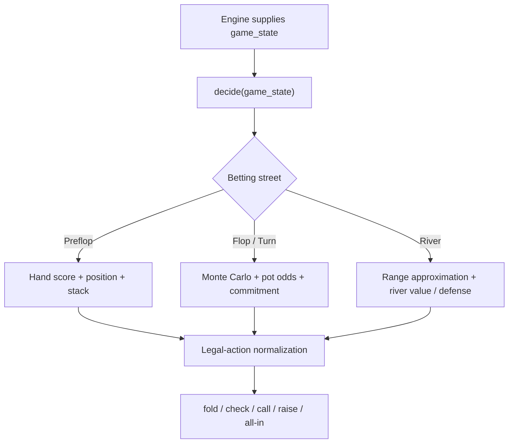

<div align="center">

# UO-Monte

### Autonomous heads-up Texas Hold'em agent

**Probabilistic simulation · Decision algorithms · Adversarial testing**

Built by a two-student team at the **University of Ottawa** for the **IEEE uOttawa × LARUS Poker Bot Hackathon (November 2026)**.

[](https://www.python.org/)
[](docs/event-spec.md)
[](my_bots/uo_monte/bot.py)
[](LICENSE)

[**Read the case study**](docs/engineering-case-study.md) · [**See the source**](my_bots/uo_monte/bot.py) · [**Explore the architecture**](docs/architecture.md) · [**Run locally**](#getting-started)

</div>

---

## Overview

**UO-Monte** is a self-contained Python agent that plays **heads-up No-Limit Texas Hold'em**. For each decision, the tournament engine supplies the available public game state and the bot chooses a legal action. The challenge: make good decisions without seeing an opponent's cards, within **2 seconds per turn** on a constrained runtime.

We combined a lightweight **position- and stack-aware preflop policy** with **Monte Carlo showdown-equity estimation**, pot-odds and stack-commitment rules, river-specific value/defense logic, and adjustments based on public opponent actions. The released agent is **rule-based and simulation-assisted**: it does not train during a match or call an external AI service.

> **Scope:** The submitted V3.4 bot is an engineering prototype evaluated with controlled practice opponents and the organizer's runtime. It is not a solved poker strategy or an assertion of competitive superiority.

## What we engineered

| Component | What it does |
| :-- | :-- |
| **Preflop policy** | Scores starting hands and adjusts opens/defense for position, stack depth and raise size |
| **Monte Carlo evaluator** | Samples unseen cards with `eval7` to estimate showdown equity |
| **Betting decisions** | Uses pot odds, board strength and stack commitment to weigh calls, folds and value bets |
| **Opponent evidence** | Uses public actions to make conservative adjustments to defensive decisions |
| **Reliability layer** | Normalizes legal actions and total-street raise sizing under strict runtime constraints |
| **Evaluation harness** | Compares candidate policies using repeatable seeds, swapped seats and diverse practice opponents |

### Decision architecture



[Architecture details](docs/architecture.md) · [Strategy implementation](docs/strategy.md)

## How we built and evaluated it

The project evolved through multiple strategies rather than one fixed implementation. We evaluated changes to preflop defense, opponent modeling, river decisions, betting frequency, value protection and a short-stack pot-odds edge case. The key lesson was that **winning additional chips in isolated hands did not necessarily improve full-match outcomes**.

To reduce card-luck bias, we used seeded matchups with swapped seats, kept candidate versions separate and inspected performance against different synthetic playing styles. We retained **V3.4** as the tournament release because later experiments did not establish a consistent improvement in the evaluation field.

**Recorded checks:**

- **37 V3.4 unit tests** passed in the release verification.
- The **official organizer validator** passed.
- The Docker sandbox image built successfully, and V3.4 completed a **46-hand sandbox freezeout** against the reference Caller, winning the match with approximately **2 ms average decision time**.
- In one frozen synthetic-opponent holdout, V3.4 won **63/108** matches versus **60/108** for a more aggressive V6-Protection candidate.

**Limitations:** The Caller match is a runtime smoke test, not a performance benchmark. Practice-opponent results are not a measure of strength against an unknown tournament field. The released strategy also uses simplified starting-hand rules and approximate opponent-range estimates. Those limitations informed our technical retrospective and ideas for future work.

[**Engineering case study**](docs/engineering-case-study.md) · [**Experiments at a glance**](docs/experiment-index.md) · [**Full chronological test record**](docs/testing.md)

## What we learned

- **Algorithm design under uncertainty:** An equity estimate is only an input; choosing an action also requires modeling the opponent's response and the value of future decisions.
- **Experimental rigor:** Seat-swapped holdouts, ablations and regression tests help identify changes that look promising but do not generalize.
- **Production constraints:** Decision deadlines, legal-action semantics, short stacks and an isolated Docker runtime are as important as strategic logic.
- **Engineering trade-offs:** Fast heuristics are easy to test and explain, but richer opponent models and multi-street expected-value analysis would be natural future directions.

## Getting started

Use **Python 3.10** in Linux or WSL Ubuntu with Git, Make and a build toolchain. The project uses the official tournament runner and engine.

```bash
git clone https://github.com/Wriskyzeus/poker-bot-hackathon.git
cd poker-bot-hackathon

uv python install 3.10
uv venv --seed -p 3.10 .venv
source .venv/bin/activate

make install
python -m unittest discover -s tests -p 'test_*.py' -v
make validate BOT=my_bots/uo_monte
python play.py my_bots/uo_monte bots/caller --seed 7
```

With Docker configured, the same reference matchup can be run in the tournament sandbox:

```bash
make sandbox
python play.py my_bots/uo_monte bots/caller --docker --seed 7
```

## Repository map

```text
my_bots/uo_monte/bot.py   Final submitted policy
pokercore/                Official game engine, validator and sandbox
bots/                     Organizer-provided reference opponents
tests/                    Regression tests
play.py                   Local match runner
docs/                     Architecture, case study, experimental history
```

[Browse the documentation](docs/README.md) · [Source attribution](docs/upstream-provenance.md)

## Credits and provenance

The two-person team used AI coding assistants to support prototyping, implementation and analysis. The submitted bot runs locally with no external inference. The poker engine, starter template, reference opponents and sandbox were provided by the [official Fullhouse Hackathon starter kit](https://github.com/FreddyyAndrews/poker-hackathon-kit) under its [MIT license](LICENSE). Our team's decision policy and testing work are separate from the organizer's infrastructure.

---

<div align="center">

**A project in probabilistic programming, software validation and engineering judgment under constraints.**

[Case study](docs/engineering-case-study.md) · [Source](my_bots/uo_monte/bot.py) · [Tests](tests/test_uo_monte_bot.py)

</div>
