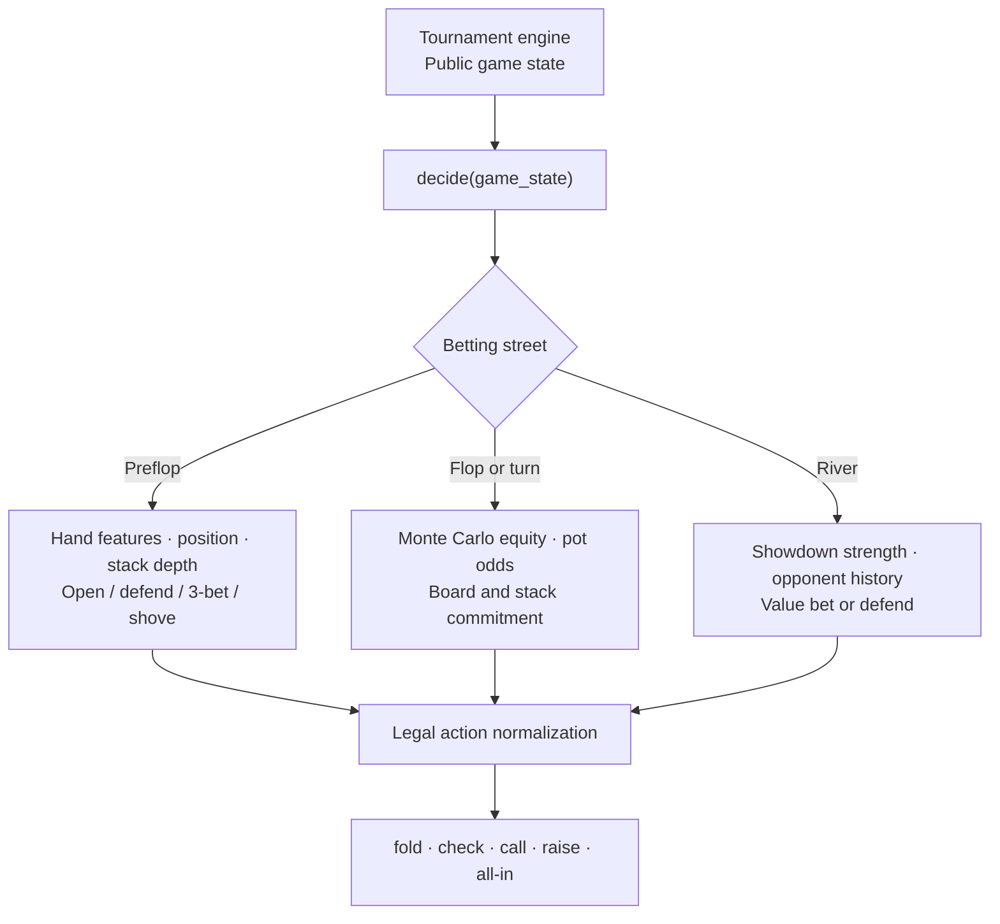

<div align="center">

# UO-Monte
### An autonomous heads-up poker agent

**Heuristic decision-making · Monte Carlo equity · Opponent-aware play**

Built by a two-student team at the **University of Ottawa** for the **IEEE uOttawa × LARUS Poker Bot Hackathon · November 2026**

[](https://www.python.org/)
[](docs/event-spec.md)
[](my_bots/uo_monte/bot.py)
[](LICENSE)

[**Explore the strategy**](docs/strategy.md) · [**Architecture**](docs/architecture.md) · [**Engineering case study**](docs/engineering-case-study.md) · [**Reproduce a match**](#run-it-locally)

</div>

---

## The project

**UO-Monte** is a self-contained Python agent for **heads-up No-Limit Texas Hold'em**. The tournament engine deals the cards and manages the game; our bot receives the legal, public game state and returns one action at a time—fold, check, call, raise or all-in.

The engineering challenge was to make **useful decisions under imperfect information** while respecting strict execution limits. We designed a fast, explainable strategy that combines stack-aware preflop heuristics, simulated hand equity, risk-sensitive betting decisions and conservative opponent adaptation.

> **Final tournament entry:** [`my_bots/uo_monte/bot.py`](my_bots/uo_monte/bot.py) · **V3.4**. This is a tested heuristic agent, **not** a game-theoretically solved system, a trained neural network or a live LLM.

## At a glance

| What we built | Why it matters |
| :-- | :-- |
| **Position- and stack-aware preflop policy** | Adjusts starting-hand decisions for blinds, button position, raises and short stacks |
| **Monte Carlo showdown equity** | Samples legal unseen cards and scores outcomes with `eval7` |
| **Pot-odds and commitment logic** | Weighs call price, remaining stack, hand strength and betting pressure |
| **Opponent-aware decisions** | Interprets recent public betting actions without accessing hidden cards |
| **Tournament-safe execution** | Returns legal actions through `decide(game_state)` within the sandbox budget |
| **Reproducible evaluation** | Uses seeded, seat-swapped matches and adversarial practice opponents |

## How the agent makes a decision



The preflop policy is deliberately lightweight. On later streets, `estimate_equity()` samples possible opponent holdings and board runouts; dedicated river logic weighs revealed information and public betting patterns. A legal-action wrapper handles bet sizing and short-stack edge cases.

**More detail:** [Design and algorithm](docs/strategy.md) · [Component architecture](docs/architecture.md)

## Validation & results

The release was selected through **matched-deal, swapped-seat freezeout testing**, rather than promoting changes based on isolated hands. Several experimental V4–V6 strategies improved selected situations but failed to establish a reliable gain in overall match outcomes.

| Check | Recorded outcome |
| :-- | :-- |
| Official starter-kit validator | **Passed** for V3.4 |
| V3.4 unit test suite | **37 tests passed** in the recorded release verification |
| Docker sandbox smoke test | **Passed** — 46-hand freezeout against the reference Caller bot; 20,000 final chips; approximately 2 ms average think time |
| V6-Protection frozen holdout | V3.4: **63/108** wins vs candidate: **60/108** |
| Final selection | **V3.4**, preserving the best broadly validated release |

**Interpretation matters:** The Docker match is a compatibility smoke test against an intentionally simple reference opponent, **not** a claim of tournament dominance. Holdout results come from a defined synthetic practice-opponent field and do not predict performance against unknown entrants. The final rare all-in price correction also passed validation but changed too few actions to justify promotion.

[**Read the concise evaluation**](docs/engineering-case-study.md#evaluation-and-release-decision) · [Full experiment record](docs/testing.md)

## Run it locally

Requires **Python 3.10**, Git, Make and a C toolchain; commands below target Linux or **WSL Ubuntu**.

```bash
git clone https://github.com/Wriskyzeus/poker-bot-hackathon.git
cd poker-bot-hackathon

# Create/activate a Python 3.10 environment (uv is one option).
uv python install 3.10
uv venv --seed -p 3.10 .venv
source .venv/bin/activate

make install
make validate BOT=my_bots/uo_monte
python3 play.py my_bots/uo_monte bots/caller --seed 7
```

To reproduce the **restricted Docker smoke test**, install Docker with WSL integration (if on Windows), then:

```bash
make sandbox
python3 play.py my_bots/uo_monte bots/caller --docker --seed 7
```

The official tournament contract specifies **Python 3.10, 2 seconds per decision, 0.5 CPU core and 768 MB memory**. The organizer's engine, validator and sandbox are provided by the starter kit.

## Repository guide

```text
my_bots/uo_monte/bot.py   Final tournament agent
tests/                    Bot regression tests
bots/                     Organizer-provided reference bots
pokercore/                Organizer-provided engine and sandbox (unmodified)
play.py                   Local match runner
docs/                     Design, evaluation and historical engineering notes
```

**New here?** Start with the [documentation index](docs/README.md). The [engineering case study](docs/engineering-case-study.md) explains the implementation and trade-offs without requiring you to read the long historical logs.

## Engineering approach & attribution

This is a **team-built, AI-assisted software engineering project**. We used coding assistants during development; the submitted agent runs locally and uses **no network service or live model**. Testing included independently authored practice opponents, controlled seed/seat comparisons, focused regression tests and failed experiments that we deliberately did **not** ship.

The poker engine, sandbox, templates and example opponents originate from the [official Fullhouse Hackathon starter kit](https://github.com/FreddyyAndrews/poker-hackathon-kit), distributed under the [MIT License](LICENSE). The UO-Monte decision policy and associated tests are the team's project work. [Upstream provenance](docs/upstream-provenance.md).

---

<div align="center">

**Built to make poker decisions that are fast, legal, measurable and explainable.**

[Implementation](my_bots/uo_monte/bot.py) · [Technical deep dive](docs/engineering-case-study.md) · [Tests](tests/test_uo_monte_bot.py)

</div>
