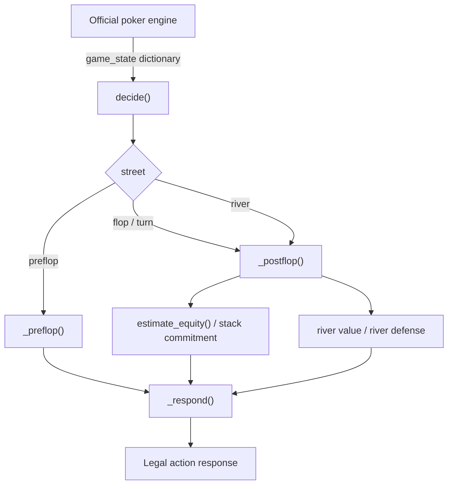

# UO-Monte Architecture

**Release:** V3.4 · **Entry:** [`my_bots/uo_monte/bot.py`](../my_bots/uo_monte/bot.py) · **Language:** Python 3.10

The submitted player is a **single self-contained Python module**. The official engine manages game mechanics; the bot sees public state and its own hole cards, returning a legal action on demand. Neither `src/` nor the research worktrees are runtime dependencies.

## Data flow

## Code components

| Component | Responsibility | Key trade-off |
| :-- | :-- | :-- |
| `decide()` | Warmup and preflop/postflop dispatch | Predictable entry-point interface |
| `_hand_features()` / `_preflop()` | Hand scoring, position, BB-normalized stack, opening and raise defense | Fast heuristic, not a solved range |
| `estimate_equity()` | Randomly sample opponent cards and remaining board, score showdowns through `eval7` | Bounded work; random-hand prior |
| `_stack_commitment()` | Analyze flop/turn calls, strong hands, draws, stack-to-pot ratio and aggression | Approximate future-game effects |
| `_river_defense()` | Price to call versus estimated opponent-conditioned equity | Limited evidence and range uncertainty |
| `_river_value_bet()` | Candidate river sizes versus weaker calls and reraise exposure | Approximate response model |
| `_opponent_history()` / `_river_aggression()` | Public betting evidence from `match_action_log` | Small samples and recent-history window |
| `_respond()` | Convert policy intentions to legal engine actions and total-street bet sizes | Engine-specific rules and edge cases |

### Runtime boundaries

The official starter kit defines the following constraints for each decision:

| Property | Constraint |
| :-- | :-- |
| Decision deadline | **2,000 ms** |
| CPU | **0.5 core** |
| Memory | **768 MB** |
| Language | **Python 3.10** |
| Network / live inference | **Not permitted** |
| Team artifact | `my_bots/uo_monte/bot.py` and optional allowed `data/` |

V3.4 uses only Python standard-library modules and the tournament-allowed `eval7` library. It does not download data, invoke a remote model or modify the engine. Its Monte Carlo sample budget is fixed by street: **320 flop, 384 turn, 512 river**.

## Correctness-critical API details

- **Heads-up position:** The button posts the small blind, acts first preflop and last postflop.
- **Bet semantics:** `{"action":"raise","amount":1200}` means *total bet on the street is 1,200 chips*, not “raise by 1,200.”
- **Current pot:** Already includes the current street's wagers.
- **Checking:** The official engine converts an invalid check when owing chips to a call, so response normalization must guard this carefully.
- **Hidden information:** Only the bot's own cards and legally revealed showdown cards are visible. Opponent tendencies come from **public betting history**, not unseen holdings.
- **State lifetime:** The process restarts for each match; the provided recent-action log retains up to 200 entries.

## Validation boundary

The tests and validator verify the team entry's action contract. A **Docker sandbox match on the final published V3.4** completed 46 hands against the reference Caller, with 20,000 final chips and approximately 2 ms average think time. This shows container compatibility for that match, not proof that every opponent or edge case is solved.

See [the evidence and limitations](engineering-case-study.md#evaluation-and-release-decision) and the [original engine contract](official-starter-kit.md).
