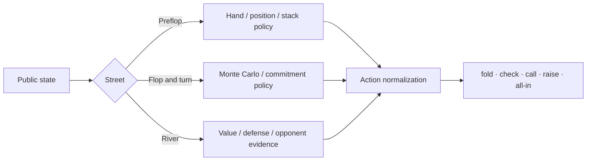

# UO-Monte — Engineering Case Study

**An autonomous, simulation-assisted heads-up poker agent**

> **Context:** IEEE uOttawa × LARUS Poker Bot Hackathon · November 21, 2026  
> **Team:** Two University of Ottawa students  
> **Final artifact:** [`my_bots/uo_monte/bot.py`](../my_bots/uo_monte/bot.py) · Release **V3.4**  
> **Stack:** Python 3.10, `eval7`, official Fullhouse engine and validator, Docker, Git, reproducible seed-based evaluation

## 1. The engineering problem

Build an autonomous player for **heads-up No-Limit Texas Hold'em**. The engine provides a game state on each turn, and the bot must return a legal action within **2,000 ms**. Runtime is constrained to **half a CPU core**, **768 MB memory**, an offline sandbox and a narrow set of approved dependencies.

This is a sequential decision problem under hidden information: the agent knows its own cards and the public board, but cannot observe the other player's private cards. It must make useful decisions with partial evidence, changing blind levels and adversaries it has never encountered.

Success was defined primarily by **winning complete freezeout matches and seat-swapped duplicate pairings**, not by producing attractive results in a few selected hands.

## 2. System design

The entry point is `decide(game_state: dict) -> dict`, implemented in a **self-contained** module. The tournament engine owns game rules and state; our code owns only the **policy**.

### Preflop: low-cost heuristics

`_hand_features()` compresses hole-card strength into a scalar, using pocket pairs, rank, suitedness and connectivity. `_preflop()` adjusts thresholds for the button/small-blind position, stack measured in big blinds, price to continue and recent opponent actions.

Very short stacks trigger approximate shove/fold logic. These are **engineering heuristics**, not Nash-equilibrium charts or exact range solutions.

### Postflop: bounded Monte Carlo sampling

`estimate_equity()` draws opponent cards and missing board cards from the **unseen deck**. Each trial evaluates a legal seven-card showdown through `eval7`.

$$
\hat{E}=\frac{N_{\text{wins}}+\frac12 N_{\text{ties}}}{N_{\text{simulations}}}
$$

Flop, turn and river use respectively **320, 384 and 512** simulations in the released policy. This is bounded runtime-cost estimation versus a **uniformly random** opponent holding. It is **not** a direct estimate against a specific opponent's conditional betting range.

### Action selection: price, risk and evidence

When facing a bet, a basic no-future-betting reference threshold is:

$$
E_{\text{break-even}}=\frac{C}{P+C}
$$

where `C` is the additional call amount and `P` is the current pot (which already includes the opponent's bet). The policy applies conservative adjustments when ranges, betting pressure or stack commitment make this reference price misleading.

On the river, specialized functions enumerate possible opposing hole-card combinations, estimate value-betting opportunities and avoid treating every aggressive betting line as a random hand. `_opponent_history()` and related functions use **public** match actions to adjust behavior cautiously.

The returned action goes through the legal-action helper, including the engine's unusual convention that a raise amount represents the **total bet on the current street**, not an increment.

## 3. Iterative development

Rather than assuming that a more complex policy must be better, we used **ablation testing**: start with a reproducible baseline, change one area and compare versions on matched seeds and swapped seats.

| Iteration | Hypothesis tested | Main takeaway |
| :-- | :-- | :-- |
| V3.4 | Conservative stack-aware policy with river value logic | Final validated baseline |
| V4 | Persistent opponent modeling and more advanced defensive EV | Did not outperform baseline overall |
| V5-P / V5-F | More selective preflop / postflop defenses | Regressions or no meaningful win advantage |
| V5-R | River overbet adaptation | Evidence gate produced no changed actions |
| V5-S / V5-A | Size-aware defense and selective reraising | Weaker or effectively identical actions |
| V6-P | 169-class preflop policy | Inconsistent gains; short-stack stress regressions |
| V6-Stab | Exploit opponents who check-fold unusually often | Won pots from exploitable opponents but lost elsewhere |
| V6-Protection | Bet moderately strong hands and draws more often | Improved development, **worsened frozen holdout** |
| Final price audit | Correct a rare terminal all-in pot-odds oversight | Correct edge case; negligible match-level impact |

The most instructive lesson was **opponent dependence**. Against a deliberately exploitable `pressure` bot, V6-Stab induced folds on **172/172** additional bets; that did **not** translate to a robust increase in complete match wins. When the opponent defended or raised, new bluffing opportunities could become liabilities.

A separate final mathematical audit found a genuine short-stack price edge case. It altered **3 of 229 eligible folds** across 800 archived matches and yielded **no additional wins** in 54 matched development games. It was preserved as research rather than shipped without meaningful release evidence.

### Evaluation and release decision

Representative matched-field results from the final V6-Protection comparison:

| Measure | Published V3.4 | Candidate V6-Protection |
| :-- | --: | --: |
| Development wins (72 games) | 43 | **45** |
| **Frozen holdout wins (108 games)** | **63** | 60 |
| Frozen holdout duplicate-pair W/D/L | **20 / 23 / 11** | 21 / 18 / 15 |
| Full-match holdout BB/hand | **+0.241** | +0.216 |

The same candidate gained chips on certain newly bet hands but could sacrifice **future value** by forcing an opponent to fold hands that would otherwise contribute more on later streets. The finished-game objective therefore took precedence over narrowly scoped hand-level gains.

**Decision:** Keep **V3.4**. No experimental revision demonstrated sufficiently consistent out-of-sample superiority to justify replacing the protected release.

**Caveat:** These results are from controlled **synthetic practice opponents**, not the actual competition field. A few-match advantage does not establish statistical certainty, and the released policy is not claimed to be optimal or unbeatable. Complete chronological measurements and exceptions are preserved in [`testing.md`](testing.md).

## 4. Reliability and validation

| Release check | Evidence |
| :-- | :-- |
| Official validator | Passed for V3.4 |
| Regression tests | 37 tests passed during release verification |
| Containerized smoke | Official Docker sandbox built and ran a **46-hand** freezeout vs reference Caller; UO-Monte won with **20,000 chips** |
| Runtime in that smoke | Approximately **2 ms average decision time**; no displayed runtime errors |
| Publication | Public `main` at `my_bots/uo_monte/bot.py` matches protected V3.4 |

The reference Caller is intentionally simple. This smoke confirms **basic sandbox compatibility**, not that rare worst-case paths or performance against unknown opponents are guaranteed. Local decision timings and synthetic benchmarks similarly cannot guarantee tournament outcomes.

The bot uses permitted local computation only. The submitted file requires **no remote AI inference, network connectivity or runtime modification of the organizer's engine**.

## 5. What this project demonstrates

**Algorithmic judgment:** Trading simulated equity precision against timing constraints, maintaining legal game semantics and explicitly handling uncertainty.

**Experiment design:** Reproducible seeds, seat-swapped freezeouts, held-out opponent comparisons, ablations and evidence-based release decisions—even when a proposed change sounds strategically attractive.

**Software reliability:** Automated tests, official validation, container smoke testing and a source-pinned final release.

**Collaboration:** A two-person engineering workflow using separate development and independent adversarial QA efforts. AI assistants supported coding and analysis; decisions and release validation remained human-controlled.

## 6. Limitations and future work

The released system retains **heuristic preflop thresholds**, approximate equity against random holdings, simplified opponent models and limited fold-equity analysis outside specific river lines. A stronger future iteration would require a better calibrated model of range-conditioned responses and multi-street expected value, supported by broader *independent* evaluation, not just more aggressive thresholds.

The generalizable conclusion is that **verifiable improvements matter more than version numbers**.

---

### Code and provenance

- [Final source](../my_bots/uo_monte/bot.py) · [Regression tests](../tests/test_uo_monte_bot.py)
- [Full evaluation archive](testing.md) · [Tournament rules](event-spec.md)
- [Organizer starter kit](https://github.com/FreddyyAndrews/poker-hackathon-kit) · [MIT notice](../LICENSE) · [Upstream provenance](upstream-provenance.md)

*This case study describes the policy and tests actually recorded for the UO-Monte project. It does not claim tournament placement, a solved GTO strategy, or use of a trained model.*
